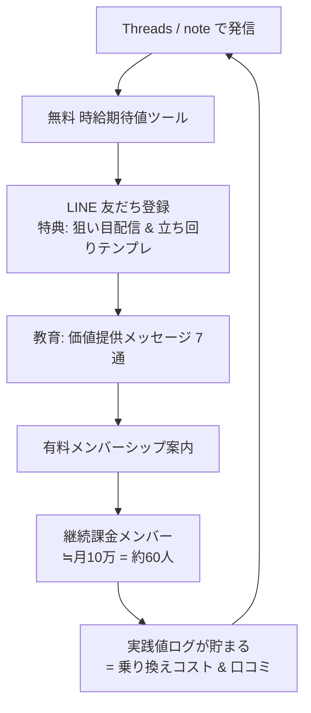

# LINE導線（登録→教育→販売）

**役割分担**: Threads/note=集客 → 無料ツール=価値の初回接触 → **LINE=関係構築と販売** → メンバーシップ=継続収益。

## ファネル全体図

## 登録特典（オファー）
- 「兼業向け・主要スマスロ狙い目まとめ（PDF）」
- 「2時間で期待値を最大化する立ち回りテンプレ」
- 「稼働ログ管理シート」
→ ツールのCTAとThreadsのD投稿から流入。

## ステップ配信（登録後7通・教育設計）
1. **歓迎＋自己開示**: 兼業当事者であること、収支を公開している姿勢。特典の受け取り方。
2. **痛みの言語化**: 「兼業は時間が敵」。専業情報が使えない理由。時給期待値という視点の提示。
3. **ノウハウ①**: やめどきの3点判断（有利区間・ゾーン・残り時間）。すぐ使える価値。
4. **ノウハウ②**: 時給期待値の計算と台選び。ツールの使い方を絡める。
5. **実践値・証拠**: 自分の月次ログ（勝ちも負けも）。「隠さない」で信頼を積む。
6. **メンバーシップの中身紹介**: 日々の狙い目配信・実践値・質問対応・限定コミュニティ。**誇大表現なし**、期待値の前提を明記。
7. **オファー＋背中押し**: 料金・入り方・「合わなければ抜けてOK」。無理に煽らない（`08`）。

## 販売の原則（正直に売る）
- 「必ず勝てる」ではなく「**期待値を積む作業を、兼業向けに効率化する**」と売る。
- リスク・向かない人（ギャンブル依存傾向、資金管理できない人）を明記して**外す**。長期の信頼＝解約率低下。
- 決済は Stripe / note / YouTubeメンバーシップ等、規約を確認して選定（`08`）。

## 計測
- 登録率（ツール利用→LINE）、開封/クリック（各ステップ）、転換率（→メンバー）、解約率。
- 目標の逆算: メンバー60人維持 = 月約9〜12万。転換率5%なら**LINE登録1,200人**が必要 → 集客規模の現実を直視する。
