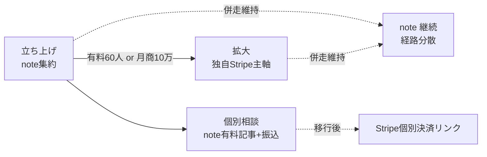
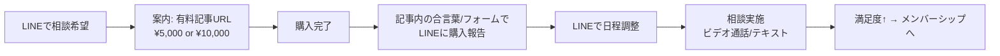

# 決済経路セットアップ手順書（トラックD｜時給ハイエナ）

ブランド名: **時給ハイエナ** / 作成: 2026-07-11

この手順書は「立ち上げ＝note集約 → 拡大＝独自Stripe併走」の決済まわりを、**実際の画面操作レベルで迷わず着手できる**ところまで落とした実務ドキュメント。関連: `08-compliance-and-risks.md`（リスク登録簿・特商法・景表法）、`09-monetization-detail.md`（料金設計・手数料）、`02-product-and-why.md`（楔・ペルソナ）、`06-line-funnel.md`（LINE導線）。

> ⚠️ 免責: 以下は一般的な整理であり法的助言ではない。各プラットフォーム規約・手数料・特商法の解釈は**着手時点で必ず一次情報を再確認**すること。金額・手数料率は変動する。有料販売の可否・表記は必要に応じて税理士/弁護士に確認。
> ⚠️ コンプラ大原則（全経路共通）: 「絶対勝てる」「必ず月収○万」「誰でも稼げる」等の**断定・誇大表現は決済ページ・プラン説明文に一切書かない**（景表法／審査リスク）。書くのは「期待値を積む作業を効率化する」「長期・試行回数前提」「結果は保証しない」。**20歳未満お断りを全プラン説明・特商法・LP に明記**。

---

## (1) 決定事項サマリ

| 項目 | 決定 |
|---|---|
| **start（立ち上げ）** | **note メンバーシップに集約**。個別相談は当面 note有料記事＋銀行振込を併用。導線は LINE公式で管理 |
| **scale（拡大）** | **独自 Stripe ＋ 自前会員サイト（Next.js）へ主軸移行**。noteは解約せず**併走**して経路分散を維持 |
| **移行トリガー** | **有料60人 到達 or 月商10万 到達**（どちらか早い方）で Stripe移行に着手 |
| **経路分散の理由** | 決済停止/アカBANは収益断絶の最大リスク（`08`リスク登録簿）。1本足打法にしない |
| **個別相談の決済** | 当面＝note有料記事（¥5,000/¥10,000）を主、銀行振込を補助。購入→LINEで日程調整 |

**なぜ note からか**: プラットフォームが特商法・年齢確認・決済の枠組みを持つため、個人が特商法表記（住所・電話）を自前で晒さずに始められる。集客記事とメンバーシップが同一基盤で回る。手数料は高い（実質約15%）が、立ち上げ期は**手数料より着手速度と守りを優先**。

**なぜ 60人 / 月商10万 で移行か**: この規模から note手数料の差額（後述 (6)）が月1万円超になり、Stripe化の会員サイト構築コストを回収できるようになる。かつメンバー数がまとまっていれば移行案内の効率も良い。



---

## (2) note セットアップ手順（チェックリスト）

> 目安所要: 半日〜1日（審査待ちを除く）。noteのメンバーシップは申請制で、審査に数営業日かかる場合がある。**リリース逆算で早めに申請**。

### A. アカウント作成（ブランド分離）
- [ ] note を**「時給ハイエナ」専用の新規アカウント**として作成する（トラックA `smcn` とは**別アカウント・別メール・別クリエイター名で完全分離**）。ジャンルが混ざるとフォロワー/ブランドが濁り、片方の規約リスクがもう片方に波及する
  - 推奨: 事業用メールを1つ用意（例: 屋号系Gmail）。SNS(Threads/X)・LINE公式・noteで**同一のブランド表記・アイコン**に統一
- [ ] プロフィール（クリエイターページ）設定
  - [ ] クリエイター名: `時給ハイエナ｜兼業スロ`
  - [ ] 自己紹介: 兼業当事者であること・実践値を公開する姿勢・**「期待値を積む前提／結果は保証しない」**の一文・**20歳未満お断り**を明記（誇大表現ゼロで）
  - [ ] アイコン/ヘッダー画像
  - [ ] SNSリンク（Threads/X・LINE公式）を設定

### B. クリエイター設定（決済の前提）
- [ ] note の「アカウント設定 → クリエイター向け設定」で**有料販売を有効化**
- [ ] **本人確認/振込口座**の登録（後述 D と同じ導線。noteは売上受取に本人情報・口座が必須）
- [ ] 販売者情報（noteが規約上の枠組みを提供するため、個人の住所公開は原則不要。ただし後述 (3) で規約と年齢/ジャンル制限を必ず確認）

### C. メンバーシップ開設の申請
- [ ] note の「メンバーシップ」機能から**開設申請**を行う（メニュー: ダッシュボード/設定内の「メンバーシップ」→「はじめる/開設する」）
- [ ] メンバーシップ名: `時給ハイエナ部`（`10-brand-and-accounts.md`の命名システムに統一）
- [ ] 説明文: 楔（`02`）ベースで**誇大表現なし**。「平日2hの兼業向けに時給期待値で狙い目を拾うための配信＋実践値＋コミュニティ」。**20歳未満お断り**・「投資/ギャンブルの結果は保証しない」を明記
- [ ] 審査ステータスを確認（**承認まで待つ**。この間に D・E を並行準備）

### D. 振込口座設定
- [ ] 売上の受け取り口座を登録（本人名義推奨。屋号口座があれば事業性が明確で望ましいが必須ではない）
- [ ] 本人確認書類の提出（求められた場合）
- [ ] 振込タイミング・最低振込額・振込手数料の条件を管理画面で確認しメモ（`09`の手取り試算に反映）

### E. プラン作成（松竹梅 ＝ `09` 準拠）

> ⚠️ **noteのメンバーシップは「プラン数の上限」「価格の刻み/上限」に制約がある場合がある**。上限や設定可能価格は**開設画面の実値で必ず確認**し、下表とズレたら**「竹 ¥1,980」を軸に据えて梅/松を調整**する（例: 3プラン不可なら竹＋松の2段、または竹単一＋松は個別相談noteで代替）。

| プラン | 価格(税込目安) | 提供内容 | 想定人数(`09`) |
|---|---|---|---|
| **梅** | ¥980/月 | 狙い目配信のみ | 30 |
| **竹（本命・軸）** | ¥1,980/月 | 配信＋実践値データ＋立ち回りテンプレ＋限定コミュニティ | 40 |
| **松** | ¥4,980/月 | 竹の全内容＋質問優先対応＋**月1回の個別相談** | 5 |

- [ ] 各プランの説明文に**共通の注意書き**を入れる:
  - 「本サービスは期待値・長期・試行回数を前提とした情報コンテンツです。**勝敗・収支を保証するものではありません**。」
  - 「**20歳未満のご利用はお断りします。** 資金管理・依存症に配慮してご利用ください。」
- [ ] 松の「月1個別相談」の提供方法（日程調整はLINE、実施はビデオ通話等）を説明文に明記
- [ ] プランごとの**限定掲示板/特典**の初期投稿を用意（空だと初回入会者が離脱する）

### F. 初期の固定記事（メンバーシップ案内）
- [ ] 「時給ハイエナ部（メンバーシップ）のご案内」記事を作成し**クリエイターページ上部に固定**
  - 楔（誰の何を解決するか）／各プランの違い（松竹梅比較表）／入り方・解約の自由（「合わなければいつでも退会OK」）／**注意書き（結果非保証・20歳未満お断り・依存症配慮）**
  - LINE公式への導線（登録特典）を設置（`06`）
- [ ] 「はじめての方へ／使い方」記事（配信の見方・過去実践値の探し方）
- [ ] 単発note（`09`層3）→ メンバーシップへの送客リンクを各記事末尾に定型で挿入

---

## (3) note 規約の事前確認（ギャンブル/攻略情報の販売可否）

> 目的: 「パチンコ・パチスロ攻略/期待値情報の有料販売」が **禁止/制限対象でないか**を、着手前に確定させる。ここを飛ばすと開設後BANで収益断絶（`08`リスク登録簿「決済停止/アカBAN」に直結）。

### 手順
1. **規約該当条項の探し方**（note 利用規約・メンバーシップ規約・ガイドライン/ヘルプを対象）
   - [ ] note公式の「利用規約」「メンバーシップの利用規約/ガイドライン」「禁止事項」ページを開く
   - [ ] ページ内検索（`Ctrl/Cmd+F`）で以下の語を順に確認: **「ギャンブル」「賭博」「パチンコ」「パチスロ」「射幸」「投資」「勧誘」「情報商材」「アダルト」「公序良俗」「換金」**
   - [ ] 「禁止行為」「販売できないもの」「利用できないコンテンツ」節に、ギャンブル攻略/情報商材が**名指しで禁止されていないか**を確認
   - [ ] 「メンバーシップで提供できないもの」の個別規定を確認（通常規約より厳しいことがある）
2. **判定**
   - [ ] 明確に禁止 → 開設しない。代替経路（後述）へ
   - [ ] 明示がない/グレー → **問い合わせ窓口で事前確認**（下記文面）。回答は**スクショ＋テキストで保存**（後日の判断根拠）
3. **問い合わせ窓口**: note ヘルプセンター内の「お問い合わせ」フォーム（クリエイター向け/メンバーシップに関する問い合わせ区分を選択）

### 問い合わせ確認文面テンプレート（そのまま使用可）
```
件名: メンバーシップで提供予定コンテンツの可否確認

お世話になっております。noteでクリエイター活動を予定している者です。
以下のコンテンツをメンバーシップおよび有料記事として販売可能か、規約上の可否を確認させてください。

【提供予定コンテンツ】
・パチスロの「期待値計算」に関する情報・解説（数値・立ち回りの考え方）
・自身の実践データ（収支記録）の共有
・上記に関する会員向けコミュニティ運営
※賭博の場の提供、換金の斡旋、勝敗の保証といった行為は一切行いません。
※20歳未満の利用はお断りする運用とし、誇大・断定的な収益表現は用いません。

これらが利用規約・メンバーシップガイドライン上で問題ないか、
また注意すべき制限事項があればご教示ください。
```

### リスク登録簿への紐づけ（`08`）
- 本確認結果（可/不可/条件付き）を `08-compliance-and-risks.md` の**リスク登録簿「決済停止/アカBAN」行の対策欄に日付＋結論を追記**して管理する。

### NGだった場合の代替
- [ ] **Ci-en / Fantia** 等のファンクラブ型（手数料**約10%**、`09`比較表）へ切り替え。ジャンル許容度がプラットフォームで異なるため、**同じ確認手順（上記1〜3）を代替先でも実施**してから移行
- [ ] それも不可なら **Stripe移行を前倒し**（自前会員サイト。特商法表記が必須になる → (5)(7)へ）
- [ ] いずれの場合も **LINE公式＝会員/導線の管理ハブは維持**（プラットフォーム非依存の資産）

---

## (4) 個別相談の決済（当面の運用）

主＝**note有料記事**、補助＝**銀行振込**。目的は初期の即金＋信頼構築（`09`）。

### 運用フロー（note有料記事方式）


- [ ] **有料記事を2本**用意（コンテンツ実体＝「兼業立ち回り診断（60分ライト） ¥5,000」「同（じっくり＋事後フォロー） ¥10,000」の案内＋購入者向け手順を記載）
  - 記事本文（無料部分）に**サービス内容・所要時間・提供方法・キャンセル規定・20歳未満お断り・結果非保証**を明記
  - 有料部分に「購入後の進め方（LINEで『相談購入しました』と連絡→日程調整）」を記載
- [ ] **銀行振込（補助）**: noteを使わない/使えない相手向け。LINEで金額・振込先・振込期限・氏名記載を案内 →入金確認後に日程調整
  - 振込先は**事業用口座**を推奨（個人生活用と分離）。入金は税務上、稼働収支と分けて記帳（`08`）
- [ ] 実施記録（日時・料金・経路）を残す（確定申告・チャーン分析用）

> 注意: 個別相談の案内でも**「必ず勝てる」「収支保証」は書かない**。「立ち回りの期待値設計を一緒に見直す」という位置づけで。

---

## (5) 特商法表記の準備（Stripe移行時に必須）

> note経由は**プラットフォームが枠組みを持つため個人の特商法表記は原則不要**。だが**独自Stripe＋自前サイトで売る瞬間から特商法表記が法的義務**（`08`）。移行してから慌てないよう、**完成形の雛形をここに用意**し、会員サイトの `/law`（特商法ページ）にそのまま設置する。

### 個人販売者と住所/電話の非公開について（注意書き）
- 特商法は原則、販売者の**氏名・住所・電話番号の表示を義務**づける。
- ただし通信販売で**「消費者からの請求があったら遅滞なく（電子メール等で）開示する」旨を明記**すれば、常時掲示を省略できる運用が広く採られている（プラットフォーム/決済側の要件次第）。**Stripe自体は特商法表記の設置を求めることがある**ため、審査/運用で不足を指摘されたら常時表示に切り替える。
- **「非公開のまま完全に伏せる」ことはできない**（請求時開示に応じる体制が前提）。バーチャルオフィス/私書箱住所の利用可否は形態により判断が分かれるため、常時公開に踏み切る前に必要なら専門家確認。

### 特商法表記テンプレート（完成形・`/law` にそのまま設置）
```markdown
# 特定商取引法に基づく表記

| 項目 | 内容 |
|---|---|
| 販売事業者名 | （氏名または屋号）※ご請求をいただいた場合、遅滞なく電子メールにて開示いたします |
| 運営責任者 | （氏名） |
| 所在地 | ご請求をいただいた場合、遅滞なく電子メールにて開示いたします |
| 電話番号 | ご請求をいただいた場合、遅滞なく電子メールにて開示いたします（お問い合わせは原則メールにて承ります） |
| メールアドレス | support@（ドメイン） |
| 販売URL | https://（会員サイトドメイン） |
| 販売価格 | 各プランページに税込で表示（例: 竹プラン 月額 ¥1,980 / 松プラン 月額 ¥4,980） |
| 商品代金以外の必要料金 | インターネット接続・通信料等はお客様のご負担となります |
| 支払方法 | クレジットカード（Stripe決済） |
| 支払時期 | 初回はお申込み時に決済。以後は毎月の同日に自動更新・自動決済されます |
| 商品の提供時期 | 決済完了後、直ちに会員コンテンツをご利用いただけます |
| 解約・退会 | 会員ページのカスタマーポータルからいつでも解約可能。解約手続き後、次回更新日以降の課金は発生しません |
| 返金・キャンセル | サービスの性質上、決済済みの月額料金の返金は原則承っておりません（法令に基づく場合を除く）。日割り返金はございません |
| 動作環境 | 最新版の主要ブラウザ（Chrome / Safari 等） |
| 年齢制限 | 20歳未満の方はご利用いただけません |
```
> ⚠️ **決済ページ・特商法ページに収益訴求（「月○万稼げる」等）を書かない**。特商法は事実表記のみ。射幸性訴求は審査/景表法リスク（`08`）。

---

## (6) 手数料比較表（`09`転記＋差額試算）

`09-monetization-detail.md`「決済経路と手取り（¥1,980の場合・目安）」を転記。手数料率は変動するため**着手時に各社で再確認**。

| 経路 | 手数料目安 | 1件手取り(¥1,980) | メモ |
|---|---|---|---|
| **独自Stripe＋自前会員サイト** | 約3.6% | 約¥1,909 | 最高収益。特商法表記/会員管理は自前 |
| **note メンバーシップ** | 実質約15%（クレカ） | 約¥1,680 | 集客/基盤が楽・規約要確認 |
| YouTubeメンバーシップ | 約30% | 約¥1,386 | 収益化条件高・顔出しNGなら動画設計要 |
| Ci-en/Fantia等 | 約10% | 約¥1,782 | ファンクラブ型・規約要確認（NG時代替） |

### 60人 × ¥1,980 時の月間手取り差額試算

| 経路 | 1件手取り | ×60人 月間手取り | note比 差額 |
|---|---|---|---|
| note メンバーシップ | 約¥1,680 | **約¥100,800** | — |
| 独自Stripe | 約¥1,909 | **約¥114,540** | **＋約¥13,740/月** |
| Ci-en/Fantia | 約¥1,782 | 約¥106,920 | ＋約¥6,120/月 |

> **note → Stripe で月 約¥13,700〜18,000 の手取り改善**（プラン構成/実手数料により幅）。年換算で約16〜22万円。この差額が会員サイト構築・維持コストを上回る＝移行トリガー（有料60人 or 月商10万）の経済的根拠。
> 併走コスト: noteは解約せず残す（経路分散）。noteに残る会員分は約15%手数料が続くが、**分散の保険料**と位置づける。

---

## (7) Stripe移行ステップ

> 前提: 移行トリガー（**有料60人 or 月商10万**）到達。noteは併走維持（`08`経路分散）。

### ステップ概要
```mermaid
flowchart TD
  A[トリガー到達<br/>60人 or 月商10万] --> B[Stripeアカウント作成・審査]
  B --> C[会員サイト構築<br/>Next.js + Checkout + Portal]
  C --> D[特商法/プライバシー/年齢確認 設置]
  D --> E[プラン(Price)作成: 梅¥980/竹¥1,980/松¥4,980]
  E --> F[note会員へ移行案内]
  F --> G[Stripe主軸 + note併走<br/>経路分散]
```

### A. Stripeアカウント審査（事業説明文例）
- [ ] Stripeアカウント作成 → 事業内容/取扱商材の入力。**射幸性・賭博と誤認されない説明**が審査通過の鍵。以下をそのまま使用可:
```
【事業内容】
パチスロの「期待値計算」に関する情報コンテンツおよび
オンラインコミュニティの月額サブスクリプション販売。
提供物は数値解説・立ち回りの考え方・実践データの共有・会員向け掲示板です。
賭博の場の提供、換金の斡旋、金銭の運用・投資助言、勝敗の保証は一切行いません。
（射幸性サービスの提供ではなく、教育・情報コンテンツの提供です。）
```
- [ ] 審査で追加情報を求められたら、上記の「賭博・換金・保証を行わない」点を強調して回答。**収益額の訴求は書かない**（景表法・審査リスク）

### B. 会員サイト構成案（Next.js）
- **フロント/認証**: Next.js（App Router）＋ 会員認証（メール/OAuth）
- **決済**: **Stripe Checkout**（サブスク作成）＋ **Stripe Customer Portal**（会員自身が解約/カード変更 → 特商法「解約」要件を満たす）
- **Webhook**: `checkout.session.completed` / `customer.subscription.updated` / `deleted` を受けて会員ステータス（有効/停止）をDB同期
- **コンテンツ配信**: 有効会員のみ狙い目配信・実践値・限定掲示板にアクセス可（ミドルウェアでガード）
- **必須ページ**: `/law`（特商法 (5)の雛形）・`/privacy`（プライバシーポリシー）・**年齢確認（20歳未満お断り）**・利用規約
- **プラン(Price)**: 梅¥980 / 竹¥1,980 / 松¥4,980 を Stripe の Product/Price として作成（月額 recurring）
- 実装は本リポジトリで Claude Code により雛形生成予定（`00`の意思決定リスト連動）

### C. note会員の移行案内（方針）
- [ ] **強制解約でなく任意移行**。「Stripe側の方が同額でより多くの実践値/機能」等の**メリット提示**で自然移行を促す（誇大訴求はしない）
- [ ] 移行期間中は**note・Stripe両方に会員が分散して存在してOK**（そのまま経路分散になる）。noteは解約せず残す
- [ ] 二重課金を防ぐ運用: 移行者はStripe登録を確認後にnote側を退会案内。LINE公式で個別に状況管理（`06`）
- [ ] 移行案内文にも**結果非保証・20歳未満お断り**を明記

### 禁止事項（Stripe移行で特に厳守）
- ❌ 決済ページ/プラン説明/特商法/LP に**断定的な収益訴求**（「月○万」「必ず」「絶対」「誰でも」）を書かない → **審査落ち・停止・景表法**に直結（`08`）
- ✅ 書くのは「期待値を積む作業を効率化」「長期・試行回数前提」「結果は保証しない」「20歳未満お断り」

---

## 付録: 着手順チェックリスト（最短ルート）
- [ ] **今すぐ**: (3) note規約の可否確認（問い合わせ文面送付）→ 結果を `08` に記録
- [ ] 可なら (2) note新規アカウント（smcnと分離）→ メンバーシップ申請 → プラン(竹軸)作成 → 固定案内記事
- [ ] 並行 (4) 個別相談の有料記事2本＋振込導線を用意
- [ ] 会員が積み上がったら (5)(7) を準備 → **有料60人 or 月商10万**で Stripe移行着手
- [ ] 全経路で **誇大表現ゼロ・20歳未満お断り** をセルフチェック（`08`景表法基準）
