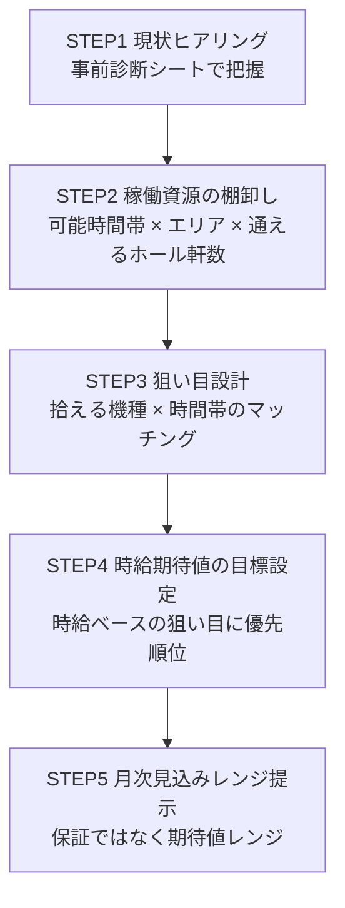
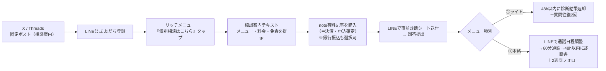

# 個別相談メニュー（Month1の即金商品）｜兼業立ち回り診断

ブランド: **時給ハイエナ** / 元設計: `09-monetization-detail.md` の「個別相談 ¥5,000〜10,000/回＝初期の即金＋信頼構築」を商品化。

> **目的の二重構造**
> 1. Month1の即金（メンバーシップ立ち上げ前の初売上）
> 2. 生の悩みを集めて、メンバーシップ／LP／noteのコンテンツに還流させる（`02`の「売れる理由＝時間がない兼業でも期待値だけを効率的に拾える」を実データで裏づける）

> **前提（`08` コンプラ厳守）**
> - 「絶対」「必ず」「誰でも」「月収○万保証」は全告知文で不使用。期待値・長期試行・リスク前提で書く。
> - **20歳未満・依存傾向の自覚がある方はお断り**を全導線に明記。
> - これは**投資助言でも賭博の勧誘でもない**。立ち回り設計と時間配分の相談。

---

## (1) メニュー2種（¥5,000／¥10,000）

| 項目 | ①ライト診断 | ②本格診断 |
|---|---|---|
| **価格** | ¥5,000（税込） | ¥10,000（税込） |
| **形式** | テキスト完結（LINE公式チャット） | 事前診断シート＋**60分通話**（音声のみ／顔出し不要） |
| **提供物** | 診断結果ドキュメント（PDF or テキスト） | 診断書（PDF）＋通話 |
| **所要時間（あなたの作業）** | 約60〜90分／件 | 約120〜150分／件（通話60分＋準備・診断書作成） |
| **納期** | 事前診断シート提出後**48時間以内**に診断結果を返却 | シート提出→**3営業日以内**に通話日程確定、通話後**48時間以内**に診断書返却 |
| **往復・フォロー** | 診断後の**質問往復2回まで**（追加確認・微修正） | 通話後**2週間のアフターフォロー**（チャットで質問可・回数上限なしだが常識の範囲） |
| **向く人** | まず自分の立ち回りを言語化して欲しい／通話は不要な人 | 腰を据えて稼働設計を固めたい／その場で相談したい人 |
| **提供チャネル** | LINE公式 | 通話は LINE通話 / Google Meet（音声）から選択 |

- 決済は**note有料記事の購入をもって申込確定**（`09`の立ち上げ＝note集約に整合。個別相談は当面 note有料記事＋銀行振込を併用）。
- 銀行振込希望者にはLINEで口座案内→入金確認後に開始（特商法上の返金条件は下記(5)を明記）。

---

## (2) 診断の中身 ＝「兼業立ち回り診断」フレーム

「残り時間 × 時給期待値で狙い目を設計する」という`02`の独自解を、その人の生活導線に落とし込む。**5ステップ**で手順化。



**STEP1｜現状ヒアリング**
事前診断シート((3))で、稼働時間・エリア・軍資金・知識レベル・現状収支・やめどき判断を把握。ここが診断の土台。

**STEP2｜稼働資源の棚卸し**
「平日/土日に実際に打てる時間帯」×「職場・自宅から行けるホールの距離と軒数」を可視化。兼業は"移動込みの時間対効果"が命なので、**移動時間を差し引いた実稼働時間**を洗い出す。

**STEP3｜拾える機種と時間帯の狙い目設計**
その人の実稼働時間帯（例: 平日21時以降／土日の朝または夕方）と回れる軒数から、**現実的に拾える立ち回り**（天井狙い・ゾーン狙い・ハイエナの入りやすさ）を機種タイプ別に整理。「朝から設定狙い」ができない兼業前提で組む。

**STEP4｜時給期待値の目標設定**
STEP3の候補を「1時間あたりの期待値（時給換算）」で並べ、限られた時間で優先すべき狙い目に順位づけ。「今この時間に打つべきか／見送るべきか」の判断基準を渡す。

**STEP5｜月次見込みレンジの提示**
STEP1〜4を踏まえ、**「保証」ではなく「期待値レンジ」**として月次の見込みを幅で提示（例:「この稼働量・この狙い目なら、長期試行前提での期待値レンジは月◯〜◯円程度。短期は上下に大きくブレます」）。
→ **必ず「長期・試行回数前提」「短期の結果は保証しない」を添える**（`08`）。

---

## (3) 事前診断シート（完成形・全13問）

申込者にそのまま送る質問リスト。LINE公式でコピペ回答してもらう。

```
【時給ハイエナ｜兼業立ち回り診断 事前シート】
お手数ですが以下13問にお答えください。回答内容をもとに診断を作成します。
（正確なほど診断精度が上がります。分かる範囲でOKです）

■ 稼働時間
1. 平日で"実際に打てる"時間帯と長さは？（例: 平日21〜23時、週2〜3回）
2. 土日・祝日で打てる時間帯と長さは？（例: 土曜の朝イチ or 夕方以降）
3. 直近1ヶ月の実際の月間稼働時間はおよそ何時間ですか？

■ エリア・ホール
4. 自宅から通えるホールは何軒ありますか？（車/電車での移動時間も）
5. 職場や生活動線の途中で寄れるホールはありますか？（あれば距離感も）
6. よく行くホールの規模感・傾向（設定入る/イベント有無など、分かる範囲で）

■ 資金・収支
7. ハイエナ稼働に回せる軍資金はいくらくらいですか？
8. 直近1ヶ月の収支はおよそいくらでしたか？（勝ち負け・ざっくりでOK）

■ 知識・スキル
9. 打てる機種の知識レベルは？（天井・ゾーン・有利区間を説明できる/なんとなく/これから、など）
10. 得意・よく打つ機種があれば教えてください。
11. 「やめどき」を今どう判断していますか？（有利区間・G数・時間などの基準）

■ 目標・その他
12. この診断で一番解決したいこと・目標は？（例: 時給を上げたい/負けを減らしたい/時間の使い方を最適化したい）
13. 時給ハイエナのLINE公式は登録済みですか？（未登録の方は登録をお願いします）
```

> 設問数は13問（受入基準の10〜15問レンジ内）。②本格診断では通話でこの回答を深掘りする。

---

## (4) 申込導線（フロー図）



**運用ルール**
- X/Threadsの**固定ポスト**に「個別相談やってます→LINEへ」の入口を常設（告知文は(6)）。
- LINE**リッチメニュー**に「個別相談」枠を用意し、タップで案内テキスト((6)LINE用)を自動返信。
- 決済は**note購入 or 銀行振込の入金確認をもって開始**。未入金では作業しない。
- 日程調整・シート送付・フォローは全てLINEで一元管理（`09`「導線はLINE公式で管理」に整合）。

---

## (5) 免責・注意事項（そのまま掲載する完成文）

```
【ご利用前に必ずお読みください】

・本サービスは、限られた時間で立ち回りを設計するための「相談・診断」です。
　投資助言・賭博の勧誘ではありません。

・お伝えする期待値・見込みは、長期・試行回数を重ねた場合の目安（期待値レンジ）です。
　短期の結果を保証するものではなく、実際の収支は上下に大きくブレます。

・診断はご提供いただいた情報にもとづく「立ち回りの提案」であり、
　利益・成果を保証するものではありません。最終的な判断・行動はご自身の責任で行ってください。

・20歳未満の方はご利用いただけません。
　また、ギャンブル等依存症の自覚・傾向がある方はお申し込みをお控えください。
　（ご相談内容によっては、稼働を勧めず一度距離を置くことをご案内する場合があります）

・返金について：
　- ライト診断／本格診断ともに、診断結果・診断書の提供を開始した後の返金はできません。
　- 提供開始前（事前診断シートの回答提出前）であれば、全額返金いたします。
　- 本格診断の通話後・診断書提供後のキャンセルは承れません。
　- 日程はご相談のうえ調整可能です。

・ご相談内容は、個人が特定されない形で発信・教材づくりの参考にさせていただく場合があります
　（望まない場合はお申し出ください）。
```

> **運用メモ（返金・特商法の実務／`08`）**: note有料記事はプラットフォーム側に販売者からの返金機能がないため、「提供開始前の全額返金」は**銀行振込で返金**する（購入者に振込先口座を確認して対応）。銀行振込での直販は通信販売に当たるため、**販売者名・連絡先を「請求があれば遅滞なく開示する」体制**を用意しておく（常時公開が不要でも請求対応の文面を準備）。メンバーシップ（`13` FAQ Q3）は note規約準拠で原則返金不可であり、**商品ごとに返金ロジックが異なる**点は意図的に書き分ける。

---

## (6) 告知文サンプル3本（景表法セルフチェック済み）

> **セルフチェック観点（`08`）**: 「絶対」「必ず」「誰でも」「100%」「月収○万保証」なし／断定・誇大なし／期待値・長期前提を明記／20歳未満お断りを明記。以下3本すべて通過。

### ① X / Threads 用（固定ポスト向け）

```
【個別相談やってます】兼業立ち回り診断

平日2hしか打てない会社員向けに、
"時給期待値"で狙い目を設計する個別相談です。

・あなたの稼働時間 × エリア × 通えるホールを棚卸し
・限られた時間で拾える機種と時間帯を一緒に設計
・時給ベースで狙い目に優先順位をつける

ライト診断¥5,000（テキスト）／本格診断¥10,000（60分通話＋2週間フォロー）

※結果を保証するものではなく、期待値は長期試行前提です
※20歳未満・依存傾向の自覚がある方はご遠慮ください

詳しくはLINEから → （リンク）
```
セルフチェック: 禁止語なし／「保証しない・長期試行前提」明記／年齢・依存配慮明記 → OK

### ② LINE 用（リッチメニューからの自動返信）

```
個別相談「兼業立ち回り診断」のご案内です。

時間の限られた兼業の方が、
"今この時間に打つべきか"を判断できるよう、
稼働時間・エリア・軍資金から立ち回りを一緒に設計します。

▼ライト診断 ¥5,000
　事前シート提出→48時間以内に診断結果を返却／質問往復2回まで

▼本格診断 ¥10,000
　事前シート＋60分通話（音声のみ・顔出し不要）
　診断書＋2週間のアフターフォロー付き

【大切なこと】
・お伝えするのは長期試行を前提とした期待値の目安です。
　短期の結果や利益を保証するものではありません。
・20歳未満の方、依存傾向の自覚がある方はお申し込みをお控えください。

お申し込み・ご質問はこのままトークでどうぞ。
まずは「相談希望」とお送りください。
```
セルフチェック: 禁止語なし／保証しない旨・長期前提を明記／年齢・依存配慮明記 → OK

### ③ note 用（有料記事＝決済ページの説明文）

```
【兼業立ち回り診断｜個別相談】

このnoteは、個別相談「兼業立ち回り診断」のお申し込み用ページです。
（購入後、LINEにて事前診断シートをお送りします）

■こんな方へ
・平日は数時間しか打てず、専業向けの立ち回りが実行できない
・限られた時間で、どの機種・どの時間帯を狙うか整理したい
・自分の時給期待値を上げる方向性を一緒に考えたい

■内容（本noteは本格診断¥10,000用です）
事前診断シート → 60分通話（音声のみ・顔出し不要）→ 診断書 → 2週間フォロー

■必ずお読みください
・お伝えするのは長期・試行回数を前提とした期待値の目安であり、
　短期の結果や利益を保証するものではありません。
・本サービスは投資助言・賭博の勧誘ではありません。
・20歳未満の方、ギャンブル等依存症の自覚・傾向がある方はご利用いただけません。
・返金は提供開始前（シート回答提出前）のみ承ります。

購入後、記事内に記載のLINEからお申し込みください。
```
セルフチェック: 禁止語なし／保証しない旨・長期前提・投資/賭博でない旨・年齢/依存・返金条件を明記 → OK

---

## (7) Month1の販売目標と還流運用メモ

### 販売目標（Month1）
| 指標 | 目標 |
|---|---|
| 販売件数 | **2〜4件** |
| 売上レンジ | **¥1〜4万**（`09`「M1〜2: ほぼ0＋個別相談数件、〜¥1万」を即金で厚くする位置づけ） |
| 内訳の目安 | ライト2件＋本格1件で¥20,000／本格2件＋ライト1件で¥25,000 など |
| 集客元 | X/Threads固定ポスト＋LINE登録者への案内（大量集客は不要。数件で成立） |

### 還流運用メモ（相談で得た悩みを資産に変える）
- **悩みログを蓄積**: 相談ごとに「よく出る悩み・つまずき・質問」を1件1メモで記録（例: やめどきの迷い／移動時間の使い方／機種の絞り方）。個人が特定されない形で。
- **メンバーシップへ**: 頻出の悩みは、メンバーシップの「立ち回りテンプレ」「Q&A」ネタに転用（`02`層2の中身を実需で埋める）。
- **LPコンテンツへ**: 相談で刺さった言葉・痛みの表現を、LP／`05`Threads投稿／`06`LINEステップ2（痛みの言語化）のコピーに反映。当事者の生声＝優良誤認を避けつつ刺さる素材。
- **noteへ**: 「兼業のやめどき判断」など汎用性の高い悩みは、単発note（`09`層3）の記事テーマに昇格させ集客導線に還元。
- **商品磨き**: 診断フレーム((2))の抜け漏れ（追加で聞くべき項目）を都度シート((3))に反映し、次回以降の精度を上げる。
- **上位導線**: 本格診断リピーターや満足度の高い相談者は、`09`「松プラン¥4,980（＋月1個別相談）」やメンバーシップへ自然に案内（押し売りしない）。

> 個別相談は不労ではないが、**初期の即金＋商品磨き＋信頼構築＋コンテンツ原料の採取**を同時に果たす、Month1で最もレバレッジの効く一手（`09`結び）。
